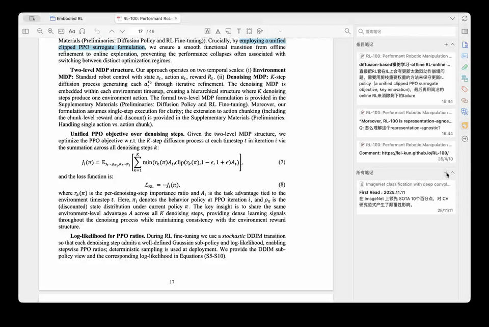

<p align="center">
  
</p>

# Zotero Paper Partner

一个 Zotero 插件，能悄悄回答你在笔记里写下的 `Q:` 问题——在后台静默完成，不打断你的阅读。


[下载插件](https://github.com/QinSihan/zotero-paper-partner/releases/latest) · [反馈问题](https://github.com/QinSihan/zotero-paper-partner/issues) · [English](./README.md)

[](./assets/demo.mp4)

---

## The idea

本插件为了一个很具体的场景而生：你在读论文，突然有某句话/某个概念没太看懂，但又懒得切换注意力去一个别的窗口问 ai 再等它回答，打断你好不容易进入的阅读状态。

现在你不再需要开新的聊天窗口，不再需要复制粘贴上下文，也不需要离开阅读状态。你只需要在当前正在写的 Zotero note 里写一行 `Q:`，然后继续往下读。过一会儿，LLM 给的答案会回填在问题下面。

```
> The model uses a representation-agnostic objective.
Q: representation-agnostic 在这里是什么意思？

A[done]: 意思是该方法不依赖某种特定的内部表示，而是能在多种编码方式下通用。
```

专注很难，阅读很累，不要让去问ai这件事情继续增加阅读负担了。

## 特点

**即问即得** 不需要读完重新整理 ai 的回答做成 Q&A 笔记，引用、问题、回答都在一个普通的 Zotero note 里。可以完全融入你原来的笔记逻辑。

**润物无声** 插件会静默处理你的问题，不会干扰你的注意力。

**轻松复现** 实现非常轻量，仓库里不止有所有源码，还有 [`target.md`](./target.md)。里面是整个实现的设计思路和一些需要用到 Zotero 9 的特性，任何人都可以把这个 Markdown 交给市面上的任何 coding Agent 来实现 Agent 复现。

---

## 安装

在[最新 Release](https://github.com/QinSihan/zotero-paper-partner/releases/latest) 里下载 `paper-partner.xpi`，然后在 Zotero 里：`工具 → 插件 → 从文件安装插件`。

## 配置

`Zotero 偏好设置 → Paper Partner` — 填入 API key、接口地址和模型名称。默认使用 DeepSeek 的 OpenAI 兼容 API。

## 环境要求

Zotero 7–10（在 Zotero 9 和 10.0.6 上测试通过）。支持任何 OpenAI 兼容的 API 接口。

---

## 开发说明

插件是一个轻量的 JavaScript 附加组件：`bootstrap.js` 包含笔记处理与 API 调用逻辑，`prefs.xhtml` 是设置界面，`manifest.json` 定义插件信息。不需要安装依赖或进行构建。

修改后，在仓库根目录运行以下命令打包（需要 `zip`）：

```sh
zip -j paper-partner.xpi manifest.json bootstrap.js prefs.xhtml icon.png icon@2x.png
```

按照上面的安装步骤，将生成的 `paper-partner.xpi` 安装到 Zotero。提交修改前，可以用一份临时笔记进行检查：

- 写一段简短上下文和一个 `Q:` 问题，按 Enter，确认回答出现在问题下方。
- 在请求进行时修改上下文，确认旧回答不会被当作有效结果静默写回。
- 检查 API 失败时是否显示 `A[error]`，并确认问题和周围的笔记内容没有丢失。

这些是手动检查；仓库目前没有自动化测试套件。[反馈问题](https://github.com/QinSihan/zotero-paper-partner/issues)时，请附上 Zotero 版本、插件版本和复现步骤。

这个项目使用了大量 AI 辅助开发，坦白说大约 99% 都是 vibe coding。原始 prompt / spec 公开放在 [`target.md`](./target.md) 中，方便你理解、复现或继续扩展这个想法。
